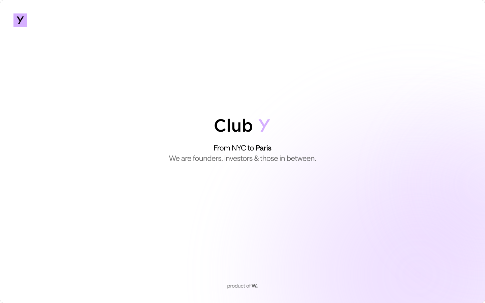
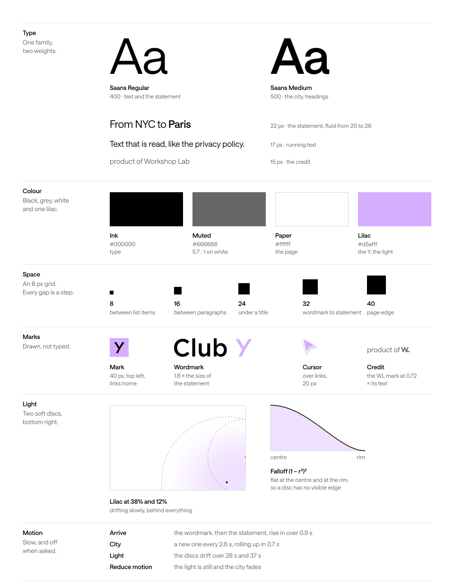

# Club Y

[club-y.co](https://club-y.co) is one page: the mark, the wordmark, a line that rolls through the cities, and the Workshop Lab credit. Static, no cookies, no third-party requests.

<p align="center">
  
</p>

## Design language



| | |
| --- | --- |
| **Type** | Saans, Regular and Medium. 15 · 17 · 22 px. The statement is fluid, 20 to 26 px. |
| **Colour** | `#000` ink, `#666` muted (5.7 : 1 on white), `#fff` paper, `#d5afff` lilac. One scheme, light. |
| **Space** | An 8 px grid: 8 16 24 32 40. The page edge runs from 20 px on a phone to 40. |
| **Marks** | The Y mark at 40 px, the wordmark at 1.8× the statement, a lilac cursor over links. |
| **Light** | Two lilac discs in the bottom right corner, at 38% and 12%, fading by (1 – r²)². On a phone they sit on the right edge and fade out before the bottom, where Safari's toolbar begins. |
| **Motion** | A 0.9 s rise on arrival, a new city every 2.6 s, a slow drift of the light. Under "reduce motion" the light is still and the city fades. |

Every token sits at the top of [`src/styles/global.css`](src/styles/global.css).

## Fundamentals

| | |
| --- | --- |
| **Stack** | [Astro](https://astro.build) 7, built to static files. Nothing from a framework runs in the browser. |
| **Weight** | Home page: 4 KB of HTML and CSS (gzipped), 48 KB of fonts, 0.4 KB of JavaScript (the city roll). |
| **Fonts** | Saans by [Displaay](https://displaay.net/about/licenses/), in `src/assets/fonts/`, trimmed to Latin. Licensed to Workshop Lab: do not reuse the files elsewhere. |
| **Security** | A content security policy in every page: only this site's own files load. To add an outside script, font or image, allow it in `astro.config.mjs`. |
| **Search** | Canonical URLs, Open Graph image, `Organization` data, a generated sitemap. The 404 is `noindex`. |

## Run

Needs Node 22.23.4 or newer. With nvm, `nvm install` in this folder installs it.

```
npm install
npm run dev       # http://localhost:4323
npm run build     # static site -> dist/
npm run preview   # serve dist/
```

## Where things live

| To change | Edit |
| --- | --- |
| The statement, the cities, the wordmark | `src/pages/index.astro` |
| Colours, type, spacing, the light | `src/styles/global.css` |
| Head, SEO, mark, footer | `src/layouts/Base.astro` |
| Privacy policy (`/privacy`, not linked from the home page) | `src/pages/privacy.astro` |
| Not-found page | `src/pages/404.astro` |
| Typeface, security policy, dev port | `astro.config.mjs` |
| Icons, share image, cursor, robots.txt | `public/` |

## Ship

Every push to `main` is built and published to GitHub Pages by [`.github/workflows/deploy.yml`](.github/workflows/deploy.yml), in about a minute. The Pages source is **GitHub Actions** and the custom domain is set in the repository's Pages settings.
